# HỆ THỐNG ĐIỂM DANH NHÂN VIÊN (GIAI ĐOẠN 3/3)
**Môn học:** Triển khai và Quản trị Hệ thống Phần mềm  
**Đề bài:** Đề 27 - Hệ thống Điểm danh Nhân viên (Hoàn thiện Log tập trung Loki/Promtail & Hardening)

---

## 1. Yêu Cầu Hệ Thống

- **Hệ điều hành:** Linux, macOS, hoặc Windows 10/11 (chạy Docker Desktop với WSL2).
- **Docker Engine:** Phiên bản 24.0.0 trở lên và Docker Compose v2 (`docker compose`).
- **Phần cứng đề xuất:**
  - CPU: Tối thiểu 2 Cores.
  - RAM: Tối thiểu 4GB khả dụng (hệ thống chạy 11 containers, tổng mức tiêu thụ thực tế ~1.2GB - 1.5GB RAM).
  - Dung lượng đĩa: Tối thiểu 10GB dung lượng trống.
- **Môi trường chạy script kiểm tra:** `bash` (Git Bash trên Windows, Terminal trên Linux / macOS / WSL).

---

## 2. Mô Tả Quá Trình Phát Triển 3 Giai Đoạn

Dự án được xây dựng và hoàn thiện theo mô hình 3 giai đoạn chuẩn kỹ thuật DevOps:

1. **Giai đoạn 1/3 - Ứng dụng Nghiệp vụ Điểm danh & Bảo mật Cốt lõi:**
   - Xây dựng ứng dụng Web điểm danh nhân viên bằng Node.js 20 LTS (Express + EJS Server-Side Rendering, không SPA).
   - Cơ sở dữ liệu MySQL 8.4 LTS với múi giờ chuẩn `Asia/Ho_Chi_Minh` và bảng mã chuẩn `utf8mb4_unicode_ci` (hỗ trợ 100% tiếng Việt có dấu).
   - Điều phối qua Nginx Reverse Proxy hỗ trợ HTTPS/TLS tự ký (tự động tạo chứng chỉ qua service `cert-gen`), chuyển hướng 301 từ HTTP sang HTTPS, thiết lập Rate Limiting (10 req/s, burst 20) và đầy đủ Security Headers (HSTS, CSP, X-Frame-Options, X-Content-Type-Options).
   - Quản trị CSDL qua phpMyAdmin chạy cô lập ở cổng máy host `127.0.0.1:8081`.
   - Bảo mật phiên: session cookie (`httpOnly`, `secure`, `sameSite: 'lax'`), mã hóa mật khẩu bằng bcrypt, chống tấn công CSRF bằng middleware token.

2. **Giai đoạn 2/3 - Hệ Thống Giám Sát Metrics (Prometheus & Grafana):**
   - Tích hợp thư viện `prom-client` thu thập metrics ứng dụng Node.js (default runtime metrics, `http_requests_total`, `http_request_duration_seconds`, và metric nghiệp vụ `attendance_checkins_total`).
   - Endpoint `/metrics` được bảo vệ: chỉ cho phép scrape từ mạng nội bộ Docker; Nginx chặn 100% truy cập từ bên ngoài bằng mã phản hồi `404 Not Found`.
   - Triển khai cụm Exporters: Nginx Prometheus Exporter (đọc `stub_status`), MySQL Exporter (sử dụng tài khoản riêng `diemdanh_exporter` với quyền tối thiểu), và Google cAdvisor (thu thập CPU, RAM, Network của container không dùng cờ `privileged`).
   - Thu thập và lưu trữ metrics với Prometheus (retention 7 ngày, user non-root `nobody`).
   - Trực quan hóa dữ liệu với Grafana: tự động nạp (provisioning) Datasource và 3 Dashboards chuẩn JSON ("Giám sát Container", "Giám sát Dịch vụ Web", "Giám sát Cơ sở Dữ liệu").

3. **Giai đoạn 3/3 - Hệ Thống Log Tập Trung (Loki & Promtail) & Hoàn Thiện Hardening:**
   - **Log tập trung:** Triển khai Grafana Loki chạy chế độ `single-binary`, lưu trữ filesystem trên volume `loki_data`, retention 7 ngày (168h), chạy user non-root (UID 10001), không công khai cổng ra máy host (Grafana truy cập nội bộ qua mạng `monitoring`).
   - **Thu thập Log với Promtail:** Sử dụng Promtail cấu hình `docker_sd_configs` tự động phát hiện container qua `/var/run/docker.sock:ro`. Gán chính xác 3 nhãn chuẩn: `service`, `container`, `job="docker"`. Tránh bùng nổ cardinality bằng cách không đưa các nhãn có độ biến thiên cao (user_id, path, ip) vào label Loki mà để trong nội dung log JSON.
   - **Ghi chú về Promtail:** *Đề bài bắt buộc dùng Promtail, dù Grafana đã khuyến nghị Alloy.*
   - **Grafana Logs Dashboard:** Provision datasource Loki và dashboard "Logs" theo dõi tốc độ sinh log theo service, tần suất lỗi 4xx/5xx của Nginx, số lần đăng nhập thất bại `login_failed`, và panel xem log trực tiếp có lọc theo service.
   - **Hoàn thiện Hardening toàn hệ thống:** Áp dụng `no-new-privileges: true` cho 100% containers, `cap_drop: [ALL]` cho toàn bộ services (chỉ Nginx giữ `NET_BIND_SERVICE`), cấu hình `read_only: true` kèm `tmpfs` cho App và Nginx, thiết lập giới hạn tài nguyên (`mem_limit` và `cpus`) cho tất cả các service, cô lập MySQL trong mạng `backend` (`internal: true`), ép buộc chính sách mật khẩu mạnh (từ chối khởi động nếu mật khẩu admin yếu hoặc dùng mẫu mặc định), và kiểm chứng tự động toàn diện bằng script `scripts/verify.sh`.

---

## 3. Sơ Đồ Kiến Trúc Hệ Thống (Mermaid)

```mermaid
flowchart TB
    subgraph Host["MÁY CHỦ VẬT LÝ / HOST"]
        UserBrowser["Trình duyệt Người dùng"]
        AdminBrowser["Trình duyệt Quản trị viên"]

        subgraph DockerCompose["DOCKER COMPOSE DEPLOYMENT"]
            
            subgraph PublicNetwork["Mạng Frontend (Mở cổng ngoài Host)"]
                Nginx["Nginx Reverse Proxy<br/>Port 80/443 (Host)<br/>non-root (UID 101)<br/>read_only + tmpfs"]
            end

            subgraph LocalAdminPorts["Cổng Quản Trị (Chỉ Bind 127.0.0.1)"]
                PMA["phpMyAdmin<br/>127.0.0.1:8081"]
                Prom["Prometheus v3.14.0<br/>127.0.0.1:9090<br/>non-root (UID 65534)"]
                Graf["Grafana v13.2.1<br/>127.0.0.1:3000<br/>non-root (UID 472)"]
            end

            subgraph AppTier["Tầng Ứng Dụng (Node.js)"]
                App["App Điểm Danh<br/>Node.js 20 LTS<br/>non-root (UID 1000)<br/>read_only + tmpfs"]
            end

            subgraph BackendNetwork["Mạng Backend (internal: true - Cô lập 100%)"]
                MySQL[("MySQL 8.4 LTS<br/>non-root (UID 999)<br/>Múi giờ Asia/Ho_Chi_Minh<br/>utf8mb4_unicode_ci")]
            end

            subgraph MonitoringNetwork["Mạng Giám Sát Nội Bộ (monitoring)"]
                Cadvisor["cAdvisor v0.55.1<br/>(unprivileged, :ro)"]
                NginxExp["Nginx Exporter v1.4.1<br/>non-root (UID 1001)"]
                MySQLExp["MySQL Exporter v0.20.0<br/>non-root (nobody)"]
                Loki["Grafana Loki v3.4.2<br/>single-binary (UID 10001)<br/>retention 7 ngày<br/>Không mở cổng host"]
                Promtail["Grafana Promtail v3.4.2<br/>docker_sd_configs<br/>(mount docker.sock:ro)"]
            end

            subgraph Volumes["Volumes Lưu Trữ Dữ Liệu"]
                vol_mysql[("mysql_data")]
                vol_prom[("prometheus_data")]
                vol_graf[("grafana_data")]
                vol_loki[("loki_data")]
                vol_cert[("cert_data")]
            end
        end
    end

    %% Luồng truy cập của User
    UserBrowser -->|HTTPS 443 / HTTP 80| Nginx
    Nginx -->|Reverse Proxy :3000| App
    App -->|SQL connection| MySQL

    %% Luồng quản trị
    AdminBrowser -->|HTTP 127.0.0.1:8081| PMA
    PMA -->|SQL connection| MySQL
    AdminBrowser -->|HTTP 127.0.0.1:9090| Prom
    AdminBrowser -->|HTTP 127.0.0.1:3000| Graf

    %% Luồng Metrics (Prometheus Scrape)
    Prom -->|Scrape /metrics| App
    Prom -->|Scrape :9113| NginxExp
    NginxExp -->|stub_status :8082| Nginx
    Prom -->|Scrape :9104| MySQLExp
    MySQLExp -->|SQL user diemdanh_exporter| MySQL
    Prom -->|Scrape :8080| Cadvisor

    %% Luồng Log (Promtail -> Loki -> Grafana)
    DockerCompose -.->|docker.sock:ro| Promtail
    Promtail -->|Push Log stream :3100| Loki
    Graf -->|Query Metrics :9090| Prom
    Graf -->|Query Logs :3100| Loki

    %% Volume bindings
    MySQL --- vol_mysql
    Prom --- vol_prom
    Graf --- vol_graf
    Loki --- vol_loki
    Nginx --- vol_cert
```



---

## 4. Bảng URL, Cổng và Quyền Truy Cập

| Dịch vụ | Địa chỉ URL | Cổng Host | Phạm vi truy cập | Tài khoản / Xác thực |
| :--- | :--- | :--- | :--- | :--- |
| **Giao diện Web Điểm danh** | [https://localhost](https://localhost) | `80`, `443` | Công khai qua Nginx SSL | Tài khoản demo nhân viên / admin |
| **Kiểm tra trạng thái (Healthz)** | [https://localhost/healthz](https://localhost/healthz) | `443` | Công khai qua Nginx | Không cần đăng nhập (`{"status":"ok"}`) |
| **Quản trị CSDL (phpMyAdmin)** | [http://127.0.0.1:8081](http://127.0.0.1:8081) | `8081` | Chỉ truy cập nội bộ máy host | Tài khoản MySQL trong file `.env` |
| **Prometheus Web UI & API** | [http://127.0.0.1:9090](http://127.0.0.1:9090) | `9090` | Chỉ truy cập nội bộ máy host | Truy cập trực tiếp (Read-only UI/API) |
| **Grafana Monitoring & Logs** | [http://127.0.0.1:3000](http://127.0.0.1:3000) | `3000` | Chỉ truy cập nội bộ máy host | Lấy từ `GF_SECURITY_ADMIN_*` trong `.env` |
| **Grafana Loki (Log Engine)** | `http://loki:3100` | *Không mở* | Chỉ nội bộ mạng `monitoring` | Grafana kết nối tự động qua datasource |
| **MySQL Database Daemon** | `mysql:3306` | *Không mở* | Chỉ nội bộ mạng `backend` | App (`diemdanh_app`), Exporter (`diemdanh_exporter`) |
| **cAdvisor / Exporters** | `cadvisor:8080`, `*:9104`, `*:9113` | *Không mở* | Chỉ nội bộ mạng `monitoring` | Prometheus scrape tự động |

---

## 5. Tài Khoản Demo và Vị Trí Cấu Hình

Toàn bộ thông tin đăng nhập được quản lý tập trung và an toàn trong tệp `.env`:

### 1. Tài khoản Đăng nhập Ứng dụng Web
- **Quản trị viên (Admin):**
  - Tên đăng nhập: `admin`
  - Mật khẩu: Giá trị biến `ADMIN_DEFAULT_PASSWORD` trong `.env` (Mặc định seed: `AdminPass_2026!`).
  - *Lưu ý an ninh:* Khi khởi động, ứng dụng sẽ tự động kiểm tra mật khẩu admin. Nếu mật khẩu có độ dài dưới 12 ký tự, thiếu ký tự hoa/thường/số/ký tự đặc biệt, hoặc chứa các giá trị mẫu không an toàn (`admin`, `123456`, `password`), ứng dụng sẽ **từ chối khởi động** và ghi log lỗi bảo mật ra stdout.
- **Nhân viên (Staff):**
  - Tên đăng nhập: `staff01` đến `staff10` (Ví dụ: `staff01`, `staff02`, ...)
  - Mật khẩu: Giá trị biến `STAFF_DEFAULT_PASSWORD` trong `.env` (Mặc định seed: `StaffPass_2026!`).

### 2. Tài khoản Grafana Dashboard
- **Tên đăng nhập:** Giá trị `GF_SECURITY_ADMIN_USER` trong `.env` (Mặc định: `admin`).
- **Mật khẩu:** Giá trị `GF_SECURITY_ADMIN_PASSWORD` trong `.env` (Mặc định: `GrafanaAdmin_2026!`).

### 3. Tài khoản Cơ Sở Dữ Liệu MySQL
- **Người dùng Ứng dụng:** `diemdanh_app` (Mật khẩu: `MYSQL_PASSWORD`). Chỉ được cấp các quyền tối thiểu `SELECT, INSERT, UPDATE, DELETE` trên CSDL `quan_ly_diem_danh`.
- **Người dùng Exporter:** `diemdanh_exporter` (Mật khẩu: `MYSQL_EXPORTER_PASSWORD`). Chỉ được cấp quyền `PROCESS, REPLICATION CLIENT, SELECT ON *.*` để thu thập metric.
- **Tài khoản Root:** Chỉ cho phép đăng nhập từ `localhost` nội bộ container MySQL, tài khoản `root'@'%'` từ xa bị vô hiệu hóa hoàn toàn.

---

## 6. Cấu Trúc Thư Mục Dự Án

```text
.
├── .env.example                     # File mẫu biến môi trường, tài liệu cách sinh mật khẩu mạnh
├── .env                             # Biến môi trường thực tế của hệ thống (bảo mật, bị .gitignore)
├── .gitignore                       # Bỏ qua node_modules, .env, certs, log
├── docker-compose.yml               # File điều phối toàn bộ 11 dịch vụ, 5 volumes, 4 networks
├── README.md                        # Tài liệu tổng thể dự án và báo cáo kỹ thuật 3 giai đoạn
├── docs/
│   ├── HARDENING.md                 # Bảng đặc tả 30 biện pháp an ninh, vị trí code và lệnh kiểm chứng
│   └── logql-queries.md             # 5 câu LogQL chuẩn kèm giải thích tiếng Việt và kết quả API thực tế
├── scripts/
│   └── verify.sh                    # Script bash tự động kiểm chứng 44 tiêu chí an ninh & vận hành
├── nginx/
│   ├── Dockerfile                   # Nginx Image chạy non-root (user: nginx, UID 101)
│   └── nginx.conf                   # TLS 1.2/1.3, Rate Limit, Security Headers, JSON log, chặn /metrics
├── loki/
│   └── loki.yml                     # Cấu hình Loki single-binary, filesystem chunks, retention 7 ngày (168h)
├── promtail/
│   └── promtail.yml                 # Cấu hình Promtail docker_sd_configs, gán đúng 3 nhãn chuẩn
├── prometheus/
│   └── prometheus.yml               # Scrape config cho app, nginx-exporter, mysqld-exporter, cadvisor
├── grafana/
│   ├── provisioning/
│   │   ├── datasources/
│   │   │   ├── prometheus.yml       # Tự động nạp datasource Prometheus
│   │   │   └── loki.yml             # Tự động nạp datasource Loki
│   │   └── dashboards/
│   │       └── dashboards.yml       # Tự động nạp toàn bộ dashboards từ thư mục JSON
│   └── dashboards/
│       ├── container.json           # Dashboard 1: Giám sát Container (cAdvisor)
│       ├── web.json                 # Dashboard 2: Giám sát Dịch vụ Web (Node.js & Nginx)
│       ├── database.json            # Dashboard 3: Giám sát Cơ sở Dữ liệu MySQL
│       └── logs.json                # Dashboard 4: Giám sát Log Tập Trung (Log rate, 4xx/5xx, login_failed)
└── app/
    ├── .dockerignore                # Loại trừ file tạm khi build image
    ├── Dockerfile                   # Multi-stage build, user non-root (node), read_only rootfs
    ├── package.json                 # Quản lý dependencies (Express, mysql2, ejs, bcryptjs, prom-client)
    ├── db/
    │   ├── schema.sql               # Định nghĩa CSDL: users, shifts, shift_assignments, attendance_logs
    │   ├── 02_permissions.sql       # Phân quyền tối thiểu cho diemdanh_app, hủy root từ xa
    │   ├── 03_exporter.sh           # Tạo user riêng diemdanh_exporter với quyền tối thiểu
    │   └── seed.js                  # Dữ liệu mẫu tiếng Việt chuẩn, ca làm và điểm danh
    ├── public/
    │   └── style.css                # Giao diện CSS tối giản, thực dụng, responsive
    ├── src/
    │   ├── db.js                    # Kết nối MySQL Pool (utf8mb4, dateStrings, auto-seed)
    │   ├── logger.js                # Bộ ghi log JSON chuẩn stdout cho Promtail thu thập
    │   ├── metrics.js               # prom-client metrics (default + http request + checkins)
    │   ├── server.js                # Express Server, xác thực mật khẩu admin, Session, CSRF, Healthz
    │   ├── middleware/              # auth.js, csrf.js
    │   ├── routes/                  # auth.js (ghi nhận event login_failed), staff.js, admin.js
    │   └── utils/time.js            # Tiện ích thời gian chuẩn múi giờ Asia/Ho_Chi_Minh
    └── views/                       # Giao diện EJS server-rendered
```

---

## 7. Hướng Dẫn Cài Đặt và Khởi Chạy Từ Đầu (Clean Start)

### Bước 1: Sao chép repository và khởi tạo biến môi trường
```bash
cp .env.example .env
```
*(Khuyến nghị: Sử dụng lệnh `openssl rand -base64 24` để tạo các chuỗi mật khẩu mạnh cho các biến trong file `.env`).*

### Bước 2: Khởi động toàn bộ hệ thống bằng Docker Compose
```bash
docker compose up -d --build
```
Lệnh trên sẽ tự động:
1. Tạo mạng và volumes cần thiết (`mysql_data`, `prometheus_data`, `grafana_data`, `loki_data`, `cert_data`).
2. Khởi tạo service `cert-gen` sinh cặp khóa TLS tự ký vào `cert_data`.
3. Build và khởi chạy các containers với đầy đủ cấu hình hardening.
4. Tự động nạp schema, phân quyền MySQL và nạp dữ liệu mẫu ban đầu.
5. Tự động nạp datasources và 4 dashboards vào Grafana.

### Bước 3: Kiểm tra trạng thái hoạt động của các container
```bash
docker compose ps
```
Toàn bộ 11 dịch vụ đều phải ở trạng thái `Up` (hoặc `Up (healthy)`).

---

## 8. Hướng Dẫn Chạy Script Kiểm Chứng Tự Động (`scripts/verify.sh`)

Dự án cung cấp kịch bản kiểm tra an ninh và vận hành tự động `scripts/verify.sh` viết bằng Bash chuẩn, tương thích hoàn toàn trên Git Bash (Windows), WSL, Linux và macOS:

### Cách chạy:
```bash
bash scripts/verify.sh
```
*(Trên Windows PowerShell, có thể thực thi thông qua Git Bash: `& "C:\Program Files\Git\bin\bash.exe" scripts/verify.sh`).*

### Script tự động kiểm tra 10 nhóm tiêu chí với 44 hạng mục:
1. **User Non-root:** Kiểm tra UID của các tiến trình trong container (`app`: 1000, `nginx`: 101, `mysql`: 999, `prometheus`: 65534, `grafana`: 472, `loki`: 10001, exporters: nobody/1001).
2. **Quản lý Cổng Mở:** Xác minh chỉ Nginx mở cổng ra ngoài host; các cổng quản trị bind `127.0.0.1`; MySQL, Loki, cAdvisor không mở cổng host.
3. **Security Headers:** Kiểm tra Nginx phản hồi đầy đủ 6 headers bảo mật (HSTS, CSP, X-Frame-Options, X-Content-Type-Options, Referrer-Policy, Permissions-Policy).
4. **Bảo vệ Endpoint Metrics:** Xác minh truy cập `/metrics` qua Nginx bị chặn bằng mã HTTP 404.
5. **Đặc Quyền CSDL Tối Thiểu:** Xác minh `diemdanh_app` chỉ có 4 quyền cơ bản, không có `ALL PRIVILEGES`, và `root'@'%'` bị xóa bỏ.
6. **Cô Lập Mạng Nội Bộ:** Xác minh mạng `backend` có `internal: true` và MySQL không thể kết nối ra ngoài Internet.
7. **Trạng Thái Scrape Targets:** Xác minh 4 targets của Prometheus (`app`, `cadvisor`, `mysqld-exporter`, `nginx-exporter`) đều `UP` (metric `up=1`).
8. **Hệ Thống Log Tập Trung:** Xác minh Loki API phản hồi tốt và nhận diện được luồng log của service `app` và `nginx`.
9. **Thuộc Tính An Ninh Container:** Kiểm tra 100% container bật `no-new-privileges`, các container áp dụng `cap_drop: [ALL]`, và `read_only: true` cho App và Nginx.
10. **Giới Hạn Tài Nguyên:** Xác minh cấu hình `mem_limit` và `cpus` trên toàn bộ container.

*Quy ước kết quả:* Script in `[PASS]` cho từng tiêu chí đạt yêu cầu, `[FAIL]` nếu có vi phạm, và kết thúc với mã thoát `exit 0` khi toàn bộ đạt chuẩn, hoặc `exit 1` nếu có bất kỳ lỗi nào.

---

## 9. Hướng Dẫn Dừng và Xóa Dữ Liệu

- **Dừng hệ thống và giữ nguyên dữ liệu:**
  ```bash
  docker compose down
  ```
- **Dừng và xóa toàn bộ dữ liệu (volumes, networks, containers) để kiểm chứng từ đầu:**
  ```bash
  docker compose down -v
  ```

---

## 10. Danh Sách Ngoại Lệ An Ninh Đã Biết (Known Exceptions)

Trong quá trình hardening hệ thống, có 4 trường hợp ngoại lệ kỹ thuật bắt buộc phải giữ lại do kiến trúc của dịch vụ, đã được đánh giá và áp dụng các biện pháp giảm thiểu rủi ro:

1. **Promtail chạy dưới User root (UID 0):**
   - *Lý do:* Đề bài bắt buộc sử dụng Promtail (mặc dù Grafana hiện khuyến nghị Alloy). Promtail sử dụng cơ chế `docker_sd_configs` cần đọc tệp socket của Docker host tại `/var/run/docker.sock`. Trên hệ điều hành Linux/Docker host, việc đọc socket này đòi hỏi quyền root hoặc thuộc nhóm docker.
   - *Biện pháp giảm thiểu:* Socket được mount ở chế độ **chỉ đọc** (`:ro`), Promtail **hoàn toàn không publish cổng ra ngoài host**, chạy trong mạng nội bộ `monitoring`, bị tước bỏ toàn bộ Linux capabilities (`cap_drop: [ALL]`), kích hoạt cờ ngăn leo thang đặc quyền `no-new-privileges: true`, và giới hạn nghiêm ngặt tài nguyên (128MB RAM, 0.25 CPU).
2. **cAdvisor chạy dưới User root (UID 0):**
   - *Lý do:* cAdvisor là công cụ phân tích cấp nhân hệ điều hành, cần đọc dữ liệu thống kê tài nguyên từ các filesystem hệ thống máy host gồm `/sys`, `/dev/disk`, và `/var/run/docker.sock`.
   - *Biện pháp giảm thiểu:* Container cAdvisor chạy **hoàn toàn không có cờ `privileged: true`**, toàn bộ mount hệ thống đều ở chế độ chỉ đọc (`:ro`), kích hoạt `no-new-privileges: true`, `cap_drop: [ALL]`, không công khai cổng ra máy host, và chỉ giao tiếp với Prometheus qua mạng nội bộ.
3. **Nginx giữ Capability `NET_BIND_SERVICE`:**
   - *Lý do:* Nginx chạy dưới user unprivileged `nginx` (UID 101). Theo chuẩn bảo mật POSIX/Linux, các cổng mạng nhỏ hơn 1024 (cụ thể là cổng 80 HTTP và cổng 443 HTTPS) yêu cầu đặc quyền mạng `CAP_NET_BIND_SERVICE` để có thể lắng nghe kết nối.
   - *Biện pháp giảm thiểu:* Tước bỏ toàn bộ tất cả các capabilities khác (`cap_drop: [ALL]` rồi chỉ bổ sung duy nhất `NET_BIND_SERVICE`), khóa hệ thống tệp gốc ở chế độ chỉ đọc (`read_only: true`), gắn các thư mục cần ghi (`/var/cache/nginx`, `/var/run`, `/tmp`) qua bộ nhớ tạm `tmpfs`, và kích hoạt `no-new-privileges: true`.
4. **phpMyAdmin khởi tạo tiến trình Apache Master dưới root:**
   - *Lý do:* Image chính thức của phpMyAdmin dựa trên nền tảng Apache Web Server. Tiến trình master của Apache cần khởi động bằng root để mở socket nội bộ cổng 80 trong container, sau đó tự động phân nhánh (fork) các tiến trình xử lý request công nhân dưới user không có đặc quyền `www-data` (UID 33).
   - *Biện pháp giảm thiểu:* Cổng của phpMyAdmin chỉ bind cục bộ tại `127.0.0.1:8081` (tuyệt đối không lộ ra ngoài mạng internet), container được áp dụng `cap_drop: [ALL]`, `no-new-privileges: true`, và giới hạn tài nguyên (128MB RAM, 0.5 CPU).
